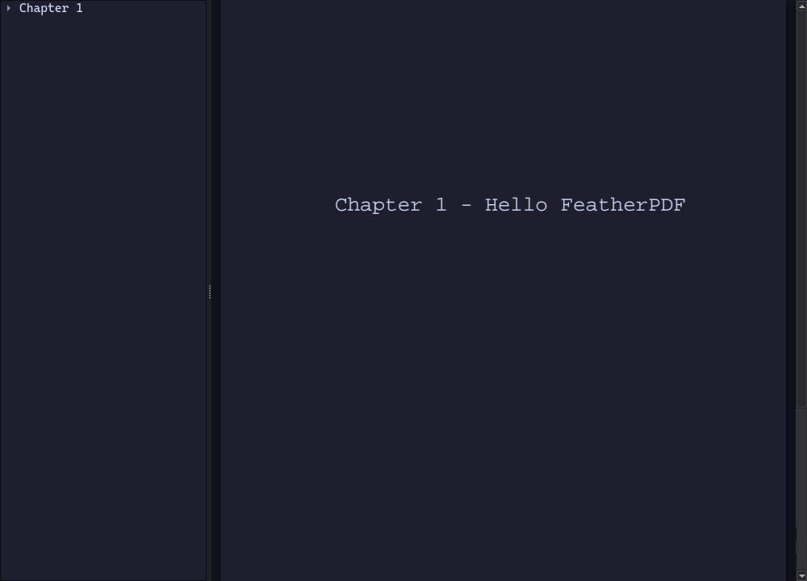

# FeatherPDF

**极致轻量的 Qt6 PDF 阅读器** —— 二进制 140 KB、零 QML、只链 Widgets + Pdf，
无标题栏 / 无菜单 / 无工具栏 / 无状态栏，界面只剩文档本身 + 一棵可隐藏的目录树，
全部操作走快捷键。为 niri / Wayland 平铺桌面而生。



## ✦ 特性

**渲染与视图（自绘，非 `QPdfView`）**
- 🎨 **4 套配色**：正常 / 反色 / **Catppuccin Mocha** / **Tokyo Night**（duotone LUT 重着色，纸面+墨色+工作区整套配色，目录树跟随主题）
- 📐 **4 种适应模式**：宽度 / 高度 / 整页 / **内容**（SumatraPDF 式内容包围盒探测，稀疏页面自动放大）
- 🔍 自由缩放（`Ctrl+滚轮` 0.05x–20x）、HiDPI（分数缩放）友好
- 📄 单页视图 + 滚轮到底自动翻页、纸张阴影、渲染缓存 32MB 封顶

**文本与链接**
- ✍️ **文字可选择**：拖选精确高亮（PDFium 文本层，逐行多边形）
- 📋 **选中即复制**：写入 primary selection，**中键粘贴**到任意应用；`Ctrl+C` 走普通剪贴板
- 🔗 **超链接可点击**：外链交给系统默认程序打开，内链跳页；悬停手型 + URL tooltip

**导航与状态**
- 🌳 **目录树侧栏**（`t` 开关，`Enter` 跳页），无书签的 PDF 自动隐藏
- 🕑 **最近文档菜单**（`Ctrl+R` 弹出，手点选择，`1`-`9` 直选）
- 💾 **每文档记忆**：页码 / 配色 / fit / 缩放，重开即恢复
- 🚀 **无参数启动自动打开上次的 PDF**；拖放 PDF 到窗口直接打开
- ❓ `F1` / `?` 快捷键帮助浮层

## ✦ 轻量化实测

| 指标 | 数值 |
|---|---|
| **二进制**（Release，`-O3 -s`） | **140 KB** |
| **RSS**（实测，含 PDF 渲染） | **~117 MB**（Qt 6.12 + PDFium 基线） |
| 链接库 | 仅 `Qt6::Widgets` + `Qt6::Pdf`（Qt 自带 PDFium） |
| 渲染缓存上限 | 32 MB（`QCache`，成本按 KB 计） |
| QML / Quick / WebEngine 运行时 | **零** |

> Qt6 把 RSS 下限钉在 ~100MB（QtGui + PDFium 无法绕开），想再低只能裸 Wayland + MuPDF，
> 那是另一个量级的项目。本项目在 Qt 生态内做到了理论下限：**UI 一个不写，CPU 全花在像素上**。
> VSZ 显示 ~33GB 是 PartitionAlloc / PDFium 的虚拟地址预留，不占物理内存。

## ✦ 构建

依赖（Arch）：`cmake` `qt6-base` `qt6-webengine`（提供 Qt6Pdf），**无需任何第三方 PDF 库**。

```bash
# CMake（推荐，Release 默认 -O3 -s）
cmake -S . -B build -G Ninja
cmake --build build
./build/featherpdf            # 无参数 → 打开上次的 PDF

# 安装 + 设为默认阅读器（可选）
cmake --install build
gio mime application/pdf featherpdf.desktop
```

<details>
<summary>qmake 备选（产物完全等价）</summary>

```bash
mkdir -p build-qmake && cd build-qmake
qmake6 ../featherpdf.pro && make -j$(nproc)
```
</details>

## ✦ 快捷键

| 按键 | 动作 |
|---|---|
| `Ctrl+O` / `Ctrl+Q` | 打开 / 退出 |
| `Ctrl+R` | 最近文档菜单（弹出手点选择，`1`-`9` 直选） |
| `j` `Space` `PgDn` `→` | 下一页（滚轮到底也翻页） |
| `k` `PgUp` `←` | 上一页 |
| `gg` / `G` / `Home` / `End` | 首页 / 末页 |
| `w` / `h` / `f` / `c` | 适应宽度 / 高度 / 整页 / 内容 |
| `+` / `-` / `Ctrl+滚轮` / `Ctrl+0` | 放大 / 缩小 / 缩放 / 回整页 |
| `i` | 循环配色（正常 → 反色 → Catppuccin → Tokyo Night） |
| `Ctrl+1` … `Ctrl+4` | 直接选配色 |
| 鼠标拖选 / `Ctrl+C` / `Ctrl+A` / `Esc` | 选择（中键粘贴）/ 复制 / 全选本页 / 取消 |
| 点击链接 | 外链系统默认程序打开，内链跳页 |
| `t` | 目录侧栏（`Enter` 跳页） |
| `F1` / `?` | 帮助浮层 |

## ✦ 配色

统一 duotone 映射（灰度 → [墨色, 纸面] 插值，保留 alpha 抗锯齿），一套 LUT 走天下：

| 主题 | 纸面 | 墨色 | 工作区 |
|---|---|---|---|
| `normal` | `#ffffff` | `#000000` | `#bdbdbd` |
| `invert` | `#000000` | `#f2f2f2` | `#262626` |
| `catppuccin` | `#1e1e2e` base | `#cdd6f4` text | `#11111b` crust |
| `tokyonight` | `#1a1b26` | `#c0caf5` | `#16161e` |

## ✦ 测试

```bash
tests/run_tests.sh      # 无头回归测试（30 项：主题落色 / fit / 选择复制 / 链接 / 记忆恢复…）
```

`tests/gen.ps` + `ps2pdf` 生成带书签和 URI 链接的测试 PDF；`tests/tocdump.cpp` 记录了
`QPdfBookmarkModel` 的行为验证。

## ✦ niri / Wayland 集成

```kdl
// ~/.config/niri/config.kdl
window-rule {
    match app-id="^featherpdf$"
    open-on-workspace "docs"
    default-column-width { proportion 0.6; }
}
binds { Mod+P { spawn "featherpdf"; } }
```

无 CSD、无标题栏，窗口边框/圆角/焦点环全部由 niri 绘制（`prefer-no-csd = true` 效果）。

## ✦ 实现要点 / 踩过的坑

1. **不能用 `QPdfView`**：内部渲染无挂钩点，反色/配色做不了 → `QPdfDocument::render()` → QImage → 自绘（`PageView : QAbstractScrollArea`）
2. **`render()` 输出透明背景**（纸张不画）：纸色要自己铺；`fit-content` 探测图必须用 `qAlpha()` 判墨迹，否则整页被判为内容
3. **`invertPixels(InvertRgba)` 是坑**：alpha 也反掉 → 页面全透明；现在统一走 duotone LUT
4. **`QPdfLink::isValid()` 对 URI 链接恒返回 false**：判可点要看 `url()` 非空或 `page() >= 0`
5. `QPdfSelection` 默认构造私有，不能直接当成员；选择/链接坐标系是**页面 pt、顶部原点**
6. `QPdfBookmarkModel::Role::Page` 是 **0-based 页索引**（用 poppler `pdftohtml` 交叉验证过）
7. 持久化键别用 `qHash(QString)`（每进程随机加盐），用 MD5
8. Wayland 下不 `saveGeometry`，窗口布局交给合成器规则

## License

自用项目，暂未选择开源许可证。Qt 部分遵循 LGPL/GPL（动态链接）。
